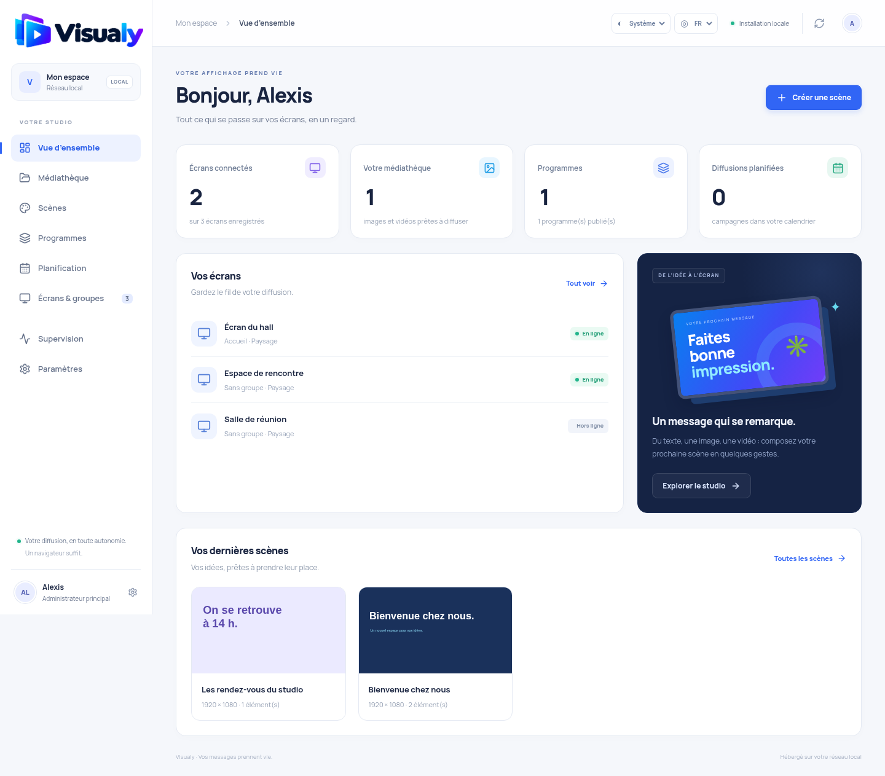

# Visualy

[English](README.md) | **Français**

Plateforme d’affichage dynamique auto-hébergée pour un réseau local : une administration web, un lecteur plein écran par appareil, une API et PostgreSQL. Le logiciel fonctionne sans compte cloud ni service externe à l’exécution. Le téléchargement initial des images Docker et des dépendances nécessite Internet ; les images peuvent ensuite être transportées vers un serveur isolé.

Screnzly devient **Visualy**. Pour une installation existante, conservez votre `.env` et vos volumes : voir [la mise à jour vers Visualy](docs/deployment.md#passage-de-screnzly-à-visualy).

## Migration du nom Docker

Avant le premier démarrage de cette version sur une installation `scenzly`, exécuter `sh scripts/migrate-visualy.sh`. Le script sauvegarde l’installation, arrête l’ancien projet et configure `visualy` pour réutiliser les mêmes volumes (`VOLUME_PREFIX=scenzly`). Il refuse un projet cible déjà présent ou des volumes inattendus. Sans ancien projet, il ne modifie rien. Les identifiants internes de base et de navigateur restent compatibles.

## Démarrer en HTTP, sans Caddy

Prérequis : Docker Engine ou Docker Desktop avec conteneurs Linux. Depuis le dossier du projet :

```sh
sh scripts/init-env.sh
```

Choisir les ports dans `.env` :

```dotenv
BIND_ADDRESS=0.0.0.0
ADMIN_PORT=8080
PLAYER_PORT=8081
```

Puis lancer :

```sh
docker compose up -d --build --wait
```

Ouvrir **http://IP_DU_SERVEUR:8080** pour l’administration et **http://IP_DU_SERVEUR:8081** pour le lecteur. Sur la machine Docker, `localhost` fonctionne aussi. Aucun domaine, certificat ou détection d’IP n’est nécessaire. Créer le premier administrateur avec `SETUP_TOKEN` du `.env`.

Le script génère seulement les secrets manquants ; conserver ceux d’une installation existante. PostgreSQL, l’API et le convertisseur restent internes. HTTP permet la lecture en ligne sur un réseau local de confiance ; les échanges ne sont pas chiffrés et le cache persistant des écrans distants nécessite HTTPS.

### Revenir de l’ancien mode Caddy au mode HTTP

```sh
git pull --ff-only
sh scripts/migrate-visualy.sh
sh scripts/init-env.sh --http
docker compose up -d --build --remove-orphans --wait
```

Cette sélection remplace les anciennes lignes `COMPOSE_*` du `.env`. Le conteneur Caddy est retiré, les volumes et secrets sont conservés. Utiliser explicitement `http://` et les ports `ADMIN_PORT`/`PLAYER_PORT`. Une reconnexion et un jumelage peuvent être nécessaires sur la nouvelle origine. Si le navigateur force HTTPS à cause d’une ancienne politique HSTS, voir [la procédure de retour à HTTP](docs/https.md#switching-from-an-earlier-caddy-installation-back-to-http).

## HTTPS optionnel

La [procédure Caddy (en anglais)](docs/https.md) décrit les changements du `.env`, le démarrage et l’installation du certificat. Docker Compose 2.24.4 minimum est requis pour les overrides.

- `sh scripts/init-env.sh --https` : HTTPS avec noms DNS.
- `sh scripts/init-env.sh --ip` : HTTPS avec l’IP existante du serveur.
- `sh scripts/init-env.sh --localhost` : HTTPS sur la machine Docker uniquement.
- `sh scripts/init-env.sh --http` : retour à HTTP direct.

Recréer toute la pile après un changement de mode : les ports et les cookies de session changent aussi. Sans option, le script conserve le mode déjà choisi. Les modes HTTPS retirent les ports HTTP directs et activent les cookies Secure.

## Premier programme

Les sélecteurs en haut de l’interface permettent de choisir le thème **clair, sombre ou système**, ainsi que la langue **français ou anglais**. Ces préférences sont mémorisées dans le navigateur, séparément pour l’administration et le lecteur. Les noms de vos médias et le contenu des scènes restent inchangés. Voir [le guide de l’interface](docs/interface.md).

1. Importez une image JPEG, PNG ou WebP, ou une vidéo MP4/WebM lisible par vos navigateurs.
2. Créez une scène ou assemblez les médias dans un programme. Réglez les durées, puis publiez le programme.
3. Ouvrez le lecteur sur l’écran à associer et recopiez son code dans l’administration.
4. Affectez un programme de secours à cet écran. Ajoutez une campagne datée ou récurrente si nécessaire.
5. Laissez le lecteur ouvert en plein écran. Les modifications publiées sont récupérées automatiquement.

Les programmes publiés conservent une révision figée : modifier un brouillon ne change pas immédiatement ce qui est diffusé. Republiez pour appliquer une nouvelle version. Un écran sans contenu affiche un visuel de secours intégré.

## HTTPS et fonctionnement hors connexion

Le lecteur fonctionne en ligne sur HTTP. Le cache après redémarrage hors connexion sur les écrans distants nécessite HTTPS et un certificat approuvé. Caddy est optionnel ; voir [la procédure HTTPS](docs/https.md).

Le mode de développement `-f compose.yaml -f compose.dev.yaml` limite HTTP à localhost, sur `DEV_ADMIN_PORT` et `DEV_PLAYER_PORT`.

## Sauvegarde et restauration

```sh
sh scripts/backup.sh
# Sur l'instance a restaurer, apres creation des conteneurs :
sh scripts/restore.sh ../visualy-backups/SCENZLY_SAUVEGARDE --replace-existing-data
```

La sauvegarde interrompt brièvement l’API pour figer les écritures et sauvegarder ensemble PostgreSQL et les médias. La restauration remplace les données existantes. Conservez les sauvegardes hors du serveur et protégez-les : elles contiennent les comptes et les données de l’application. Détails dans [le guide d’exploitation](docs/deployment.md).

## Développement et tests

Le monorepo utilise Node.js 22+ et npm workspaces :

```sh
npm ci
npm run build
npm test
```

`npm run dev:api`, `npm run dev:admin` et `npm run dev:player` lancent les services de développement. L’API nécessite `DATABASE_URL` et un `MEDIA_DIR` accessible en écriture. Les deux serveurs Vite proxient `/api` vers l’API sur le port 3000. Le déploiement Docker reste la méthode la plus simple pour démarrer l’ensemble.

Les tests d’intégration modifient une instance dédiée et vide ; ne les exécutez pas sur une installation utilisée :

```sh
SCENZLY_TEST_URL=http://127.0.0.1:8080 npm run test:smoke
```

Les détails du contrat sont dans [docs/api-contract.md](docs/api-contract.md). Les points d’entrée sont `apps/admin`, `apps/player`, `apps/api` et `packages/shared` pour les types et la planification.

## Périmètre de cette première version

Cette base couvre le parcours local de création, publication, jumelage et diffusion. Elle n’implémente pas encore la totalité du cahier des charges : import PowerPoint, éditeur avancé avec groupes/annuler-rétablir, historique de restauration des versions, récupération de compte par email, quotas par organisation et intégrations matérielles restent à développer. FFmpeg et Poppler assurent les conversions vidéo et PDF dans le service de conversion isolé.

Les vidéos sont lues sans son par défaut pour respecter les règles d’autoplay des navigateurs. Le démarrage automatique en mode kiosque, l’heure NTP, l’allumage de la dalle et sa mise en veille se configurent sur l’appareil. Les événements de lecture décrivent le rendu du navigateur ; ils ne prouvent pas l’affichage physique de la dalle. La recette matérielle, les performances 4K et l’autonomie hors connexion doivent être vérifiées sur vos écrans cibles.

## PostgreSQL 18 et import PDF

Les nouvelles installations utilisent PostgreSQL 18, avec le volume `visualy_postgres18-data` monté sur `/var/lib/postgresql` (organisation propre aux images PostgreSQL 18).

**Installation existante PostgreSQL 17 : ne lancez pas directement `docker compose up`.** Après récupération du nouveau code, et pendant que votre ancien conteneur PostgreSQL 17 fonctionne, lancez :

```sh
sh scripts/migrate-postgres18.sh
```

Le script construit les images, sauvegarde la base et les médias, arrête les écritures, démarre PostgreSQL 18 dans un nouveau volume et restaure les données. Il refuse une cible non vide. Le volume PostgreSQL 17 et la sauvegarde restent conservés. En cas d’échec de restauration, l’API reste arrêtée ; conservez les volumes et utilisez la sauvegarde pour diagnostiquer. Ne supprimez aucun ancien volume avant validation.

Dans **Médiathèque → Documents PDF**, importez un document (25 Mo, 50 pages maximum). Le traitement en arrière-plan crée une image PNG par page, disponible pour les scènes et programmes. La file est persistée dans PostgreSQL et reprise au redémarrage. L’interface affiche les imports en attente, terminés ou en erreur. Les tâches sont orchestrées par l’API et exécutées par le convertisseur isolé, à concurrence limitée à un document par instance API ; la conversion vidéo dispose de sa propre file persistante.

## Conversion vidéo

Dans **Médiathèque → Conversion vidéo**, importez un MP4/MOV, MKV/WebM ou AVI. La conversion en arrière-plan crée un nouveau média MP4 H.264, pixels YUV420p, audio AAC stéréo si la source contient du son et index `faststart` pour la lecture web. Une source sans piste audio est acceptée. Le fichier initial n’est pas publié ; seul le résultat complet rejoint la médiathèque.

Limites : 500 Mo, 1 heure, dimensions source 8192 pixels maximum ; sortie limitée à 1920 × 1080 en conservant le ratio. Une conversion utilise deux threads et expire après 15 minutes. Un travail par instance API est traité à la fois, indépendamment des imports PDF. La file reprend les travaux interrompus après redémarrage ; les erreurs sont visibles dans l’interface. Les fichiers sources temporaires sont supprimés après succès ou échec définitif. L’import direct des médias existant reste disponible sans conversion.

Les tests de conversion nécessitent FFmpeg/ffprobe et Poppler sur la machine qui lance `npm test`. Pour vérifier aussi la lecture Chromium sur une instance de recette vide : `SCENZLY_CHROMIUM=/usr/bin/chromium npm run test:smoke`.

## Interface

Identité visuelle aux couleurs de Visualy, navigation adaptative, éditeur de scènes et écran de jumelage harmonisés. Logos et polices sont servis localement. Voir la [recette visuelle](docs/interface.md).


