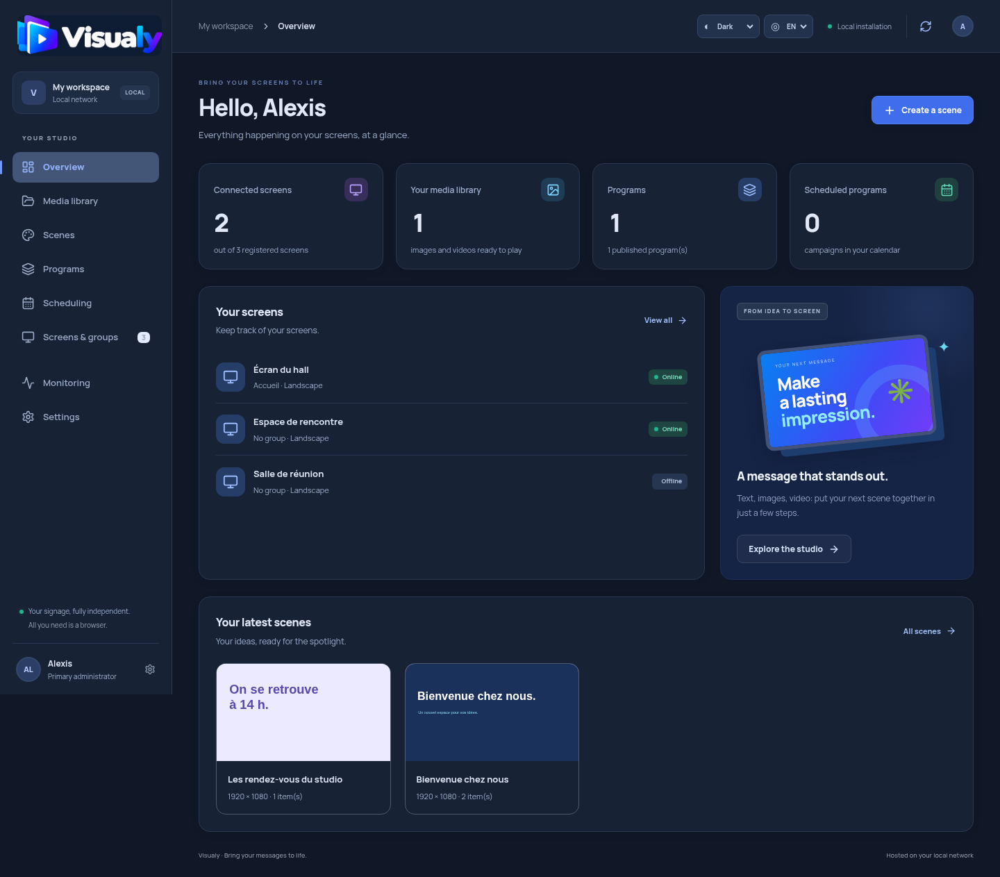

# Visualy

**English** | [Français](README.fr.md)

Self-hosted digital signage for your local network. Create content, schedule playback, and manage your screens from a web interface hosted on your own server.

Visualy includes an administration app, a full-screen browser player, an API, PostgreSQL 18, and an isolated media converter. It runs without a cloud account or external services at runtime. Internet access is needed initially to download Docker images and dependencies; built images can then be transferred to an isolated server.



> **Upgrading from Screnzly?** Keep your existing `.env` and Docker volumes. The application is now called Visualy, while persistent identifiers remain compatible with existing installations. Read the [upgrade notes (French)](docs/deployment.md#passage-de-screnzly-à-visualy) and [security migration guide (French)](docs/security/hardening.md) before restarting. For an existing PostgreSQL 17 installation, follow the [PostgreSQL 18 migration instructions](#migrating-from-postgresql-17) below before starting the new stack.

## Features

- Upload images and browser-compatible videos, convert PDFs into slides, and transcode videos for web playback.
- Compose scenes, assemble programs, and publish fixed revisions.
- Pair screens, organize them into groups, and assign fallback programs.
- Schedule dated or recurring campaigns and monitor player activity.
- Switch between English and French, with light, dark, and system themes.
- Play cached content offline after synchronization over trusted HTTPS.
- Start directly over HTTP by IP, with optional Caddy HTTPS by IP, DNS, or localhost.

## Upgrading an existing Docker installation

Docker now displays **visualy** as the project and image name. Before starting this version on an existing `scenzly` installation, run:

```sh
sh scripts/migrate-visualy.sh
```

The script backs up the old installation, stops its containers, and records `COMPOSE_PROJECT_NAME=visualy` and `VOLUME_PREFIX=scenzly` in `.env`. The new containers reuse the same database, media, and Caddy certificate volumes. It refuses unexpected volume layouts or an already existing `visualy` project instead of combining data. With no old project, it does nothing. Keep the generated backup and use the selected startup procedure below. Internal database roles, browser keys, and backup formats retain compatible identifiers.

## Requirements

- Docker Engine with Docker Compose, or Docker Desktop using Linux containers on Windows/macOS.
- **Docker Compose 2.24.4 or later** for the HTTPS and development overrides.
- A suggested starting point of 4 CPU cores, 6 GB RAM, and enough storage for your media.
- A browser on each playback device. Video performance depends on the device and its supported codecs.

Run shell scripts through a POSIX shell; on Windows, use WSL or Git Bash. Optional HTTPS IP detection may need adjustment inside WSL, a VM, or a host with multiple interfaces or a VPN. Plain HTTP needs no detection.

## Quick start: HTTP on your local network

No Caddy, DNS, certificate, or IP detection is needed for the default deployment.

```sh
git clone https://github.com/razerman16/Visualy.git
cd Visualy
sh scripts/init-env.sh
```

Choose the direct HTTP ports in `.env`:

```dotenv
BIND_ADDRESS=0.0.0.0
ADMIN_PORT=8080
PLAYER_PORT=8081
```

Start the stack:

```sh
docker compose up -d --build --wait
docker compose ps -a
```

For a server at `192.168.1.50`, open:

| Application | URL |
| --- | --- |
| Administration | `http://192.168.1.50:8080` |
| Player | `http://192.168.1.50:8081` |

Use the server's actual IP and your chosen ports. On the Docker host, `http://localhost:8080` and `http://localhost:8081` also work. The server firewall must allow the chosen ports from your local network. `CADDY_IP` is an internal Docker address, not the address to open in a browser.

The initialization script generates missing secrets and preserves existing ones. Do not replace the database password of an initialized installation. `migrate` should exit with code `0`; the other services should remain running. Only the web services publish ports; the API, PostgreSQL, and converter stay internal.

Open administration and use the **`SETUP_TOKEN`** from the server's `.env` to create the first administrator account. Initial setup closes once that account exists. Do not commit `.env`.

### Already using the previous Caddy setup?

Select HTTP explicitly to replace the old Compose mode in `.env`, then recreate the services:

```sh
git pull --ff-only
sh scripts/migrate-visualy.sh
sh scripts/init-env.sh --http
docker compose up -d --build --remove-orphans --wait
```

This removes the old Caddy container from the active stack while preserving data and certificate volumes. Keep your existing secrets. Use **`http://`** and the configured `ADMIN_PORT`/`PLAYER_PORT`. Sign in and pair the player again at the new origin. Browsers may remember an HSTS policy from earlier HTTPS visits; see the [switching guide](docs/https.md#switching-from-an-earlier-caddy-installation-back-to-http) if HTTP is automatically upgraded.

## Optional HTTPS with Caddy

HTTP supports online use on a trusted LAN. It does not encrypt credentials or content. Persistent offline playback on remote screens requires trusted HTTPS.

Follow the [Caddy HTTPS guide](docs/https.md) for the full procedure: select a mode, edit `.env`, recreate the services, and install the local root certificate.

| Mode | Selection command | Settings |
| --- | --- | --- |
| Direct HTTP (default) | `sh scripts/init-env.sh --http` | `ADMIN_PORT`, `PLAYER_PORT` |
| HTTPS with DNS | `sh scripts/init-env.sh --https` | `ADMIN_DOMAIN`, `PLAYER_DOMAIN`, `CADDY_HTTP_PORT`, `CADDY_HTTPS_PORT` |
| HTTPS by server IP | `sh scripts/init-env.sh --ip` | `SERVER_IP`, Caddy ports, `CADDY_PLAYER_HTTPS_PORT` |
| HTTPS on localhost | `sh scripts/init-env.sh --localhost` | Caddy ports, `LOCAL_PLAYER_HTTPS_PORT` |

HTTPS modes automatically remove the direct HTTP web ports and enable Secure cookies. Recreate the complete stack when switching modes; restarting Caddy alone is not sufficient. Each mode preserves the same database and media volumes. The default command without a mode flag preserves an existing `.env` selection.

For localhost-only HTTP development, explicitly use `-f compose.yaml -f compose.dev.yaml`; ports are controlled by `DEV_ADMIN_PORT` and `DEV_PLAYER_PORT`.

## Publish your first program

1. Upload a JPEG, PNG, or WebP image, or an MP4/WebM video your browsers can play.
2. Create a scene or assemble media into a program. Set playback durations and publish it.
3. Open the player on a screen and enter its pairing code in the administration app.
4. Assign a fallback program to that screen. Add a dated or recurring campaign if needed.
5. Leave the player open in full-screen mode. It retrieves published updates automatically.

Published programs retain a fixed revision. Editing a draft does not immediately change what is playing; publish again to apply a new version. A screen without assigned content displays a built-in fallback.

Use the interface controls to choose English or French and a light, dark, or system theme. Preferences are saved in the browser separately for administration and player origins. User-entered names and scene content are not translated.

## PDF and video conversion

### PDF imports

In **Media library → PDF documents**, upload a PDF of up to **25 MB and 50 pages**. Background processing creates one PNG image per page for use in scenes and programs. The queue is persisted in PostgreSQL and resumes after restart. The interface shows pending, completed, and failed jobs.

The API coordinates jobs and sends conversion work to the isolated converter service. PDF imports are limited to one active job per API instance; video conversion has its own persistent queue.

### Video conversion

In **Media library → Video conversion**, upload an MP4/MOV, MKV/WebM, or AVI file. Conversion produces an H.264 MP4 with YUV420p pixels, stereo AAC audio when present, and a `faststart` index for web playback. Sources without audio are supported. Only the completed output is added to the media library.

Limits:

- Input: **500 MB**, **1 hour**, and source dimensions up to **8192 pixels**.
- Output: up to **1920 × 1080**, preserving the aspect ratio.
- Processing: two threads per conversion, a 15-minute timeout, and one video job at a time per API instance.

Interrupted jobs resume after restart. Errors appear in the interface, and temporary source files are removed after success or final failure. Direct media upload remains available without conversion.

## Offline playback and device setup

The player caches its interface and synchronized media locally. HTTPS and a certificate trusted by the device are required. Test network loss and browser restarts on your actual playback devices before relying on offline operation; browser storage limits and eviction policies still apply.

Videos play muted by default to comply with browser autoplay rules. Configure kiosk startup, time synchronization, display power, and sleep settings on each device. Playback events describe browser rendering; they do not prove that a physical display is on. Validate hardware compatibility, 4K performance, and offline duration on your target screens.

## Backup and restore

```sh
sh scripts/backup.sh
# On the destination installation, after creating the containers:
sh scripts/restore.sh ../visualy-backups/YOUR_BACKUP_DIRECTORY --replace-existing-data
```

Backup briefly stops the API to freeze writes and capture PostgreSQL and media together. Restoration replaces existing data. Keep protected copies off the server: backups include application accounts and content. Back up `.env` and Caddy's persistent volumes separately; the application backup script does not include them.

Existing `scenzly` volumes and backup formats remain readable after migration. New installations use the `visualy` project name. See the [operations guide (French)](docs/deployment.md) for the complete procedure.

## Migrating from PostgreSQL 17

New installations use PostgreSQL 18, with `visualy_postgres18-data` mounted at `/var/lib/postgresql` as required by the PostgreSQL 18 image layout.

**Do not start the new stack directly against an existing PostgreSQL 17 installation.** After fetching the new code, while the old PostgreSQL 17 container is still running, execute:

```sh
sh scripts/migrate-postgres18.sh
```

The script builds images, backs up the database and media, stops writes, starts PostgreSQL 18 with a new volume, and restores the data. It refuses a nonempty target. The PostgreSQL 17 volume and backup are preserved. If restoration fails, the API stays stopped; retain the volumes and backup for recovery. Do not remove old volumes before validating the migration.

## Development and tests

The monorepo uses **Node.js 22+** and npm workspaces:

```sh
npm ci
npm run build
npm test
npm run test:security
```

Conversion tests require FFmpeg, ffprobe, and Poppler on the machine running the tests.

`npm run dev:api`, `npm run dev:admin`, and `npm run dev:player` start the development services. The API needs a valid `DATABASE_URL` and a writable `MEDIA_DIR`; see the deployment configuration for its other environment settings. The Vite servers proxy `/api` to port `3000`. Docker is the simplest way to run the complete stack.

Integration tests create and modify data. Run them only against a dedicated, disposable installation, supplying its test credentials and initial setup token where required:

```sh
SCENZLY_TEST_URL=http://127.0.0.1:8080 npm run test:smoke
# Optional Chromium playback checks:
SCENZLY_CHROMIUM=/usr/bin/chromium npm run test:smoke
```

The `SCENZLY_*` test environment variables retain their original names for compatibility.

| Directory | Purpose |
| --- | --- |
| `apps/admin` | Administration interface |
| `apps/player` | Screen player and offline playback |
| `apps/api` | API, persistence, and conversion services |
| `packages/shared` | Shared types, scheduling, and translations |

## Current scope

Visualy covers local content creation, publishing, screen pairing, scheduling, and playback. It does not yet implement the entire original specification. PowerPoint import, advanced editor grouping and undo/redo, published-version restoration history, email-based account recovery, per-organization quotas, and hardware integrations remain future work.

Logos and fonts are served locally without a CDN. The interface adapts to desktop and mobile layouts.

## Further documentation

The main README is available in English and [French](README.fr.md). The detailed guides below are currently in French:

- [Optional HTTPS with Caddy (English)](docs/https.md)
- [Deployment, networking, HTTPS, and operations](docs/deployment.md)
- [Security hardening and upgrade procedure](docs/security/hardening.md)
- [Internal API contract](docs/api-contract.md)
- [Interface and visual verification](docs/interface.md)
